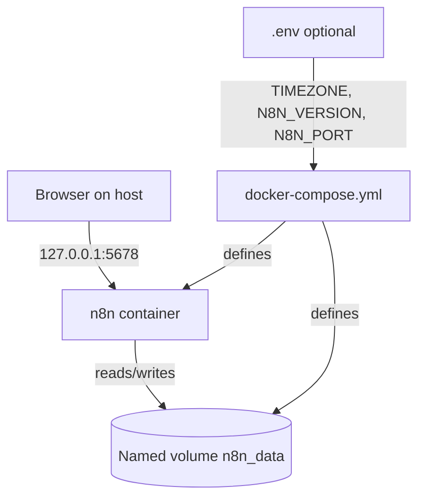

# Architecture Spine — n8n-local

**Done when:** `docker compose ps` shows `n8n` as `healthy` and `http://127.0.0.1:5678/healthz` returns HTTP 200.

An architecture decision (AD) below is a rule that every change to this setup must respect. All five are adopted.

## Design Paradigm

**Single-container appliance.** One n8n service, embedded SQLite, no queue mode, no external database, no reverse proxy. Everything the user needs is one compose file and one volume.



## Invariants & Rules

### AD-1 — One compose file is the only launch path

- **Binds:** all
- **Prevents:** per-OS scripts or divergent `docker run` commands that drift between Windows and Linux Mint.
- **Rule:** `docker-compose.yml` at the project root is the single definition of the service. Both OSes start it with `docker compose up -d`. No OS-specific variants.

### AD-2 — State lives only in a named volume

- **Binds:** n8n data (workflows, credentials, settings, encryption key, SQLite database)
- **Prevents:** data loss on container removal, Windows path or Linux uid permission differences from bind mounts, and a new empty volume appearing when the project folder is renamed.
- **Rule:** the named volume `n8n_data` (fixed `name:` in compose, not derived from the folder name) is mounted at `/home/node/.n8n`. No bind mounts for n8n state. No state is stored in the container filesystem. `docker compose down -v` deletes the volume; the README warns against it. Back up the whole volume, with the container stopped, before any version change and before any `down -v`.

### AD-3 — Local-only exposure

- **Binds:** network
- **Prevents:** the instance being reachable from the LAN by accident.
- **Rule:** the host port (default 5678, `N8N_PORT`) is published on `127.0.0.1` only. Exposing it further needs a new AD.

### AD-4 — Official image, pinned tag

- **Binds:** image selection
- **Prevents:** unreviewed third-party images, and silent version drift (including unplanned major-version jumps).
- **Rule:** image is `docker.n8n.io/n8nio/n8n`, tag from `N8N_VERSION`, defaulting to the pinned verified version (2.46.6). Changing the version is a deliberate edit, preceded by a backup (AD-2).

### AD-5 — Configuration through compose and optional `.env` only

- **Binds:** configuration
- **Prevents:** settings scattered across shell profiles or per-machine flags.
- **Rule:** n8n settings are `environment:` entries in the compose file, fed by `.env` variables with defaults. `.env` is git-ignored; `.env.example` is committed. No secrets are committed.

## Consistency Conventions

| Concern | Convention |
| --- | --- |
| Naming | Service `n8n`; volume `n8n_data`; no fixed `container_name` |
| Data & formats | Timezone set through `TIMEZONE`, applied to both `TZ` and `GENERIC_TIMEZONE`. Default `Europe/Paris` is a placeholder; set your own |
| Security | `N8N_ENFORCE_SETTINGS_FILE_PERMISSIONS=true` set in the compose file; no auth layer beyond n8n's owner account |
| Reliability | Restart policy `unless-stopped`; compose healthcheck on `/healthz` |
| Observability | Logs via `docker compose logs` |

## Stack

| Name | Version |
| --- | --- |
| n8n (docker.n8n.io/n8nio/n8n) | 2.46.6, stable at 2026-11-09 (docs.n8n.io), pinned as the default |
| Docker Compose file format | no `version:` key (Compose Specification) |
| Docker Desktop (Windows) | current [ASSUMPTION: install not verified on the authoring machine, `docker` not on its PATH; company licence to be confirmed] |
| Docker Engine + Compose plugin (Linux Mint) | current [ASSUMPTION: not verified; Mint is not an official Docker target, use the Ubuntu repository and the `docker` group] |

## Structural Seed

```text
n8n-local/
  docker-compose.yml   # the service and volume
  README.md            # start, stop, update, backup, restore
  .env.example         # committed template: TIMEZONE, N8N_VERSION, N8N_PORT
  .env                 # optional, git-ignored copy of the template
  .gitignore           # ignores .env and backup archives
```

## Deferred

- **Database:** SQLite is enough for learning use. Move to PostgreSQL only if workflows or load outgrow it.
- **Encryption key management:** n8n generates a key inside the volume, so a full-volume backup carries it. Set `N8N_ENCRYPTION_KEY` explicitly only if you restore data into a different volume or machine without the original key file.
- **Public access / webhooks from the internet (e.g. Telegram):** needs a tunnel or reverse proxy plus `WEBHOOK_URL`. Decided when the first project needs it.
- **Automatic backups:** manual backup and restore commands are in the README. Scheduling waits until there is data worth protecting.
